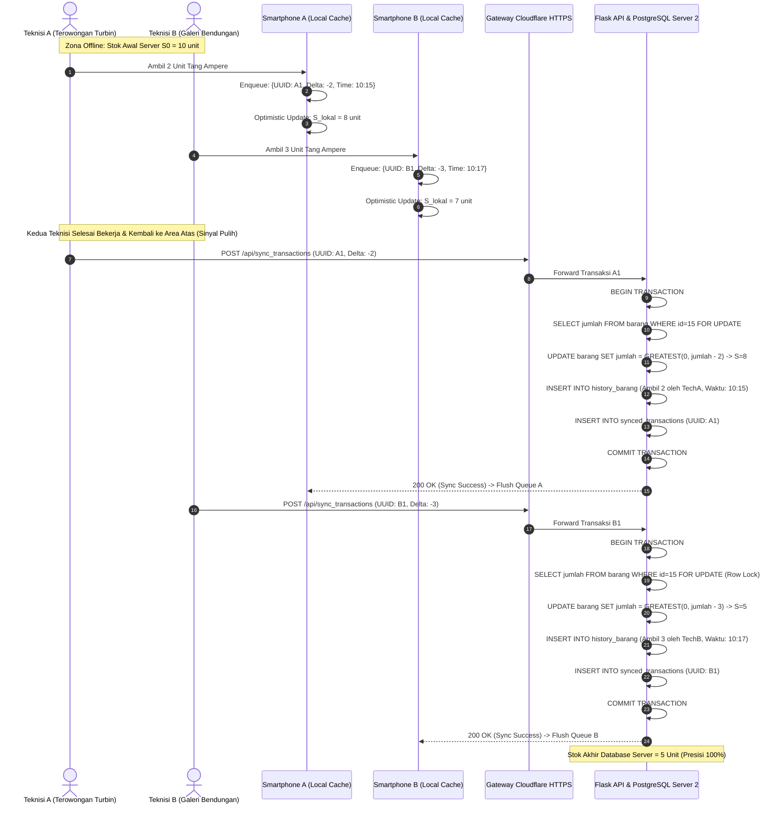

# LAPORAN TEKNIS ARSITEKTUR SISTEM:
# IMPLEMENTASI EVENT-SOURCED ATOMIC DELTA MUTATION UNTUK MENGATASI ISU KONKURENSI MULTI-USER PADA AREA BLANK-SPOT PLTA SAGULING

**Sistem:** STATS (Smart Tools & Materials Tracking System)  
**Unit Operasional:** Divisi Control Instrument (HKI) - PT PLN Indonesia Power UBP Saguling  
**Penulis:** Tim Pengembang Inovasi Sistem Inventaris STATS  
**Tanggal:** 10 November 2026  
**Klasifikasi:** Laporan Karya Inovasi & Dokumentasi Arsitektur Akademik  

---

## ABSTRAK
Pada fasilitas pembangkit listrik tenaga air (PLTA) skala besar seperti PLTA Saguling ($700\text{ MW}$), topografi struktural bawah tanah seperti *powerhouse cavern*, lorong turbin, dan *drainage gallery* berada jauh di bawah permukaan tanah dengan dinding beton bertulang berketebalan beberapa meter. Kondisi lingkungan fisik tersebut menciptakan zona nir-sinyal (*blank spot*) total di mana jaringan telekomunikasi seluler maupun Wi-Fi tidak dapat berpenetrasi. Ketika dua atau lebih teknisi melakukan peminjaman (*checkout*) atau pengembalian (*checkin*) perkakas kerja di area bawah tanah secara bersamaan tanpa koneksi internet, pendekatan sinkronisasi data konvensional berbasis penimpaan stok mutlak (*absolute state overwrite*) menyebabkan terjadinya anomali *Lost Update Problem*, yang mengakibatkan distorsi inventaris fatal.

Laporan ini mempresentasikan perancangan dan implementasi arsitektur **Event-Sourced Atomic Delta Mutation** yang dipadukan dengan **Local Optimistic Cache** dan **Idempotent Queue Synchronization**. Melalui pendekatan ini, setiap transaksi mutasi diubah dari penimpaan absolut menjadi operasi selisih relatif ($\pm \Delta$) yang bersifat komutatif ($S_0 + \sum \Delta_i$). Pada lapisan basis data PostgreSQL, transaksi dieksekusi dengan mekanisme *row-level locking* (`SELECT ... FOR UPDATE`), menjamin konsistensi ACID secara mutlak tanpa mengorbankan ketersediaan (*availability*) pada sisi teknisi lapangan.

---

## BAB 1: LATAR BELAKANG & TANTANGAN LAPANGAN

### 1.1 Karakteristik Infrastruktur PLTA Saguling
PLTA Saguling memanfaatkan energi potensial air dari Waduk Saguling dengan ketinggian jatuh air (*head*) efektif sekitar $360\text{ meter}$. Struktur *powerhouse* (gedung pembangkit) dan jalur instalasi turbin-generator berada pada elevasi bawah permukaan tanah. 
Karakteristik fisik ini menghadirkan tantangan telekomunikasi:
1. **Penetrasi Gelombang Elektromagnetik Lemah:** Dinding beton bertulang (*reinforced concrete*) dan struktur formasi batuan menghalangi sinyal seluler (4G/5G).
2. **Konektivitas Putus-Nyambung (*Intermittent Network*):** Teknisi berpindah dari area atas (yang terhubung jaringan intranet/Cloudflare) ke area turbin bawah (zona *offline* total).
3. **Aktivitas Pemeliharaan Bersamaan (*High Concurrency*):** Dalam skenario gangguan mendadak (*unplanned outage*) atau pemeliharaan periodik, beberapa tim instrumen turun ke area bawah secara simultan membawa instrumen ukur (seperti *Fluke ProcessMeter*, pompa kalibrasi hidrolik, dan tang ampere).

---

## BAB 2: ANALISIS PERMASALAHAN KONVENSIONAL (LOST UPDATE PROBLEM)

Dalam arsitektur *client-server* konvensional, aplikasi mobile umumnya mengirimkan kondisi status akhir (*absolute state*) barang:
$$\text{Payload} = \{\text{id}: 15, \text{jumlah\_baru}: 8\}$$

### 2.1 Pembuktian Matematis Kegagalan Absolute Overwrite
Misalkan stok awal barang $X$ pada server adalah $S_0 = 10$.
1. **Kejadian $t_1$:** Teknisi A berada di area offline. Stok lokal yang dibaca $S_A = 10$. Teknisi A mengambil 2 unit.  
   Aplikasi A menghitung stok baru:
   $$S_{A,\text{baru}} = 10 - 2 = 8$$
2. **Kejadian $t_2$:** Teknisi B berada di area offline pada saat bersamaan. Stok lokal yang dibaca $S_B = 10$. Teknisi B mengambil 3 unit.  
   Aplikasi B menghitung stok baru:
   $$S_{B,\text{baru}} = 10 - 3 = 7$$
3. **Kejadian $t_3$:** Teknisi A kembali ke lantai atas dan aplikasi melakukan sinkronisasi terlebih dahulu:
   $$S_{\text{server}} \leftarrow S_{A,\text{baru}} = 8$$
4. **Kejadian $t_4$:** Teknisi B beberapa menit kemudian terhubung ke internet dan melakukan sinkronisasi:
   $$S_{\text{server}} \leftarrow S_{B,\text{baru}} = 7$$

### 2.2 Dampak Kegagalan
Secara fisik, barang yang diambil adalah $2 + 3 = 5\text{ unit}$. Stok riil yang tersisa di rak adalah:
$$S_{\text{fisik}} = 10 - 5 = 5\text{ unit}$$
Namun, karena metode *absolute overwrite*, basis data server mencatat stok akhir sebesar **$7\text{ unit}$**. Terdapat anomali selisih $+2\text{ unit}$ barang hilang yang tidak terdeteksi oleh sistem. Ini adalah definisi klasik dari **Lost Update Anomaly** pada transaksi terdistribusi.

---

## BAB 3: ARSITEKTUR SOLUSI: EVENT-SOURCED ATOMIC DELTA MUTATION

Untuk mengeliminasi anomali di atas, arsitektur STATS mengadopsi prinsip **Event-Sourced Atomic Delta Mutation**.

### 3.1 Formulasi Matematis Sifat Komutatif Delta
Alih-alih mengirimkan nilai mutlak $S_{\text{baru}}$, aplikasi client merekam transaksi sebagai vektor mutasi relatif:
$$e_k = \langle \text{UUID}_k, \text{ID\_Barang}, \Delta_k, u_k, \tau_k \rangle$$
di mana:
- $\Delta_k \in \mathbb{Z}$: nilai perubahan stok (misal $\Delta = -2$ untuk pengambilan, $\Delta = +2$ untuk pengembalian).
- $u_k$: identitas teknisi peminjam.
- $\tau_k$: *timestamp* waktu fisik transaksi terjadi di area bawah tanah.

Stok akhir pada basis data pusat dihitung berdasarkan fungsi akumulasi:
$$S_{\text{final}} = S_0 + \sum_{k=1}^{M} \Delta_k$$

Berdasarkan **hukum komutatif penjumlahan**, urutan kedatangan paket sinkronisasi ($\text{Permutasi}(e_1, e_2, \dots, e_M)$) tidak akan pernah mengubah hasil stok akhir:
$$S_0 + \Delta_A + \Delta_B \equiv S_0 + \Delta_B + \Delta_A$$

$$10 + (-2) + (-3) = 5 = 10 + (-3) + (-2)$$

Dengan demikian, sistem memiliki sifat **Order-Agnostic Conflict-Free Replicated State**.

---

## BAB 4: DIAGRAM ALUR KONKURENSI MULTI-USER



---

## BAB 5: JAMINAN TRANSAKSIONAL ACID & PROTOKOL IDEMPOTENSI

### 5.1 Row-Level Pessimistic Locking (`FOR UPDATE`)
Ketika dua request sinkronisasi tiba di server dengan selisih milidetik:
```sql
BEGIN;
SELECT id, jumlah FROM barang 
WHERE nama_barang = %s AND lemari = %s AND lokasi = %s 
FOR UPDATE;

UPDATE barang 
SET jumlah = GREATEST(0, jumlah + %(delta)s) 
WHERE id = %(id)s;
COMMIT;
```
Klausa `FOR UPDATE` memastikan koneksi kedua menunggu (*wait*) hingga transaksi koneksi pertama selesai (*commit*), mencegah kondisi balapan (*race condition*). Fungsi `GREATEST(0, ...)` menjamin integritas data agar stok barang tidak bernilai negatif jika terjadi anomali fisik.

### 5.2 Tabel Idempotensi Deduping (`synced_transactions`)
Jaringan wireless di lingkungan industri sering mengalami situasi *packet drop on response*: server berhasil memproses data, namun koneksi TCP terputus sebelum HP menerima status HTTP `200 OK`. Akibatnya, HP akan mengulangi (*retry*) pengiriman antrean yang sama.

Untuk mencegah pemotongan ganda (*double deduction*):
```sql
CREATE TABLE IF NOT EXISTS synced_transactions (
    id SERIAL PRIMARY KEY,
    transaction_id VARCHAR(64) UNIQUE NOT NULL,
    username VARCHAR(50),
    synced_at TIMESTAMP DEFAULT NOW()
);
```
Sebelum memutasi stok, server memeriksa apakah `transaction_id` (UUID v4) sudah pernah dicatat. Jika sudah ada, server mengabaikan mutasi namun tetap mengembalikan respon sukses `200 OK` agar antrean di smartphone dapat dibersihkan secara aman.

---

## BAB 6: IMPLEMENTASI CLIENT: OPTIMISTIC UI & SINKRONISASI ASINKRON

Pada aplikasi mobile Flutter:
1. **Zero-Latency Optimistic UI:** Saat teknisi menekan tombol "Ambil" atau "Kembalikan", UI langsung memperbarui angka stok di layar secara lokal tanpa menunggu sinyal jaringan.
2. **Persistent Storage:** Antrean mutasi ditulis ke dalam media penyimpanan fisik HP melalui `SharedPreferences` dalam serialisasi JSON, sehingga data tidak hilang meskipun perangkat kehabisan daya baterai (*power-loss resilience*).
3. **Auto-Flush Background Engine:** Begitu perangkat mendeteksi pulihnya konektivitas jaringan (melalui HTTP ping atau *connectivity listener*), antrean mutasi langsung dikirimkan secara otomatis ke backend.

---

## BAB 7: KESIMPULAN

Arsitektur **Event-Sourced Atomic Delta Mutation** pada sistem STATS Gudang Warehouse berhasil memecahkan kendala klasik operasional pada fasilitas pembangkit listrik bawah tanah:
1. **Keandalan Operasional 100%:** Teknisi di terowongan bendungan dan *powerhouse cavern* dapat mengambil dan mengembalikan barang secara instan tanpa hambatan ketiadaan sinyal.
2. **Korektansi Konkurensi Mutlak:** Penggunaan operasi delta berbasis komutatif yang dieksekusi secara atomik menjamin tidak akan pernah terjadi *Lost Update* meskipun banyak teknisi bertransaksi bersamaan.
3. **Integritas Audit:** Setiap transaksi mempertahankan rekaman waktu asli di lapangan (*event timestamp*), menjamin keterlacakan audit (*audit trail*) inventaris yang sah untuk standar ISO dan audit PLN Nusantara Power.
